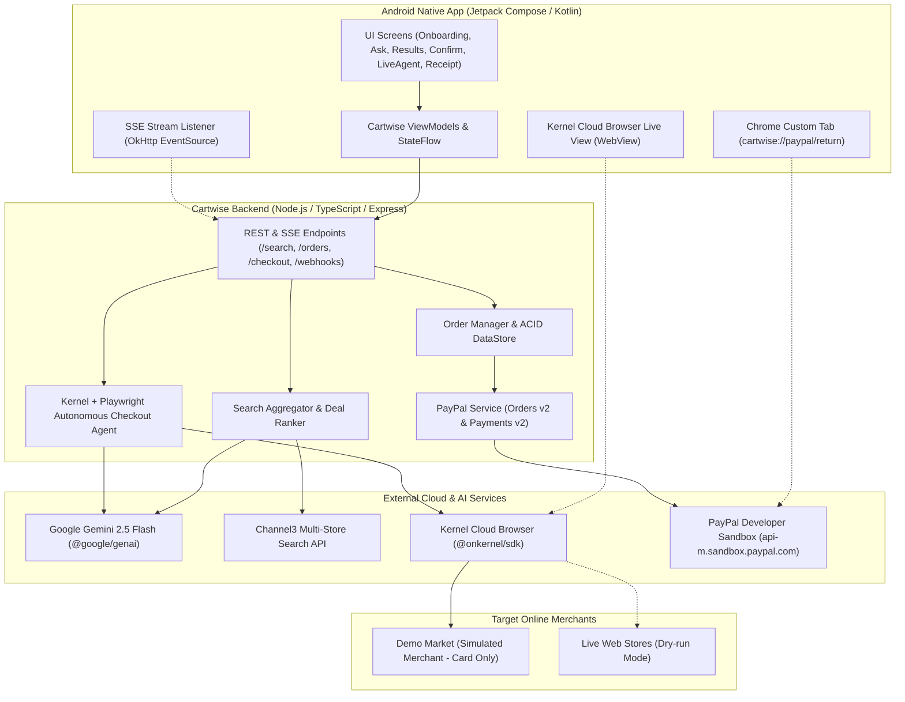

# 🛒 Cartwise: Autonomous AI Shopping Agent Powered by PayPal

> **Submission for the PayPal AI Hackathon 2026 on Devpost**  
> *Find the best real deal across the web, approve safely with PayPal escrow, and let your AI agent buy for you — even from stores that don't accept PayPal.*

[](https://opensource.org/licenses/MIT)
[](https://developer.paypal.com/)
[](https://ai.google.dev/)
[](https://docs.trychannel3.com/)
[](https://www.kernel.sh/)
[](https://developer.android.com/)

---

## 🌟 1. The Product & The Problem

### The Problem
Cross-border and online shoppers — particularly in emerging markets like Nigeria, Ghana, Kenya, and across the globe — face a major dilemma:
1. **PayPal is their most trusted, chargeback-protected payment method.**
2. However, **thousands of independent e-commerce stores and regional retailers do not accept PayPal** — they only accept direct credit/debit card numbers.
3. Shoppers waste hours comparing prices, calculating volatile international shipping costs, and risk card fraud or refusal when using personal local cards on foreign merchant websites.

### The Solution: The "Buy-For-Me" Escrow Model
Cartwise bridges this gap:
1. **You tell Cartwise what you want** via natural language (e.g., *"Find wireless noise-cancelling earbuds under $40 that ship to Lagos"*).
2. **AI Intent & Multi-Store Search:** Google Gemini extracts your constraints, queries Channel3 across online retailers, calculates true landed cost (item + shipping to Nigeria), and recommends the top 3 verified deals.
3. **PayPal Escrow Authorization (Orders v2):** You approve payment using PayPal Orders v2 with `intent=AUTHORIZE`. **Your money is held in escrow, not taken.**
4. **Autonomous Cloud Browser Agent (Kernel + Playwright):** Cartwise boots an isolated cloud browser via **Kernel**. The agent navigates the store, enters your delivery address, and completes checkout using Cartwise's commercial purchasing card. **You watch the live browser stream in real time inside the Android app.**
5. **Double-Safety & Two Paths:**
   - **Happy Path:** Merchant confirms order $\rightarrow$ Cartwise **captures** the PayPal authorization $\rightarrow$ Instant receipt with merchant order ID and PayPal capture ID.
   - **Failure Guardrail (Out of Stock / Error):** If the item sells out during checkout $\rightarrow$ Cartwise immediately **voids** the PayPal authorization $\rightarrow$ Held funds are released back to your PayPal balance and you see *"You were not charged."*

---

## 🏛️ 2. Architecture Diagram



---

## 💳 3. PayPal APIs & AI Tools Used

| Tool / API | How It Is Used in Cartwise |
| :--- | :--- |
| **PayPal Orders v2 (`intent=AUTHORIZE`)** | Generates the transaction hold for item price + shipping + Cartwise service fee ($3.00). Returns approval link for buyer authentication. |
| **PayPal Orders v2 (`/v2/checkout/orders/{id}/authorize`)** | Executes payment authorization once the buyer approves in PayPal, returning the `authorization_id`. |
| **PayPal Payments v2 (`/v2/payments/authorizations/{id}/capture`)** | Captures authorized funds when the merchant confirms order placement. |
| **PayPal Payments v2 (`/v2/payments/authorizations/{id}/void`)** | Voids the authorization hold if checkout fails or item is out of stock, ensuring the user is never charged. |
| **PayPal Webhooks v1** | Verifies signature and synchronizes state on `CHECKOUT.ORDER.APPROVED`, `PAYMENT.AUTHORIZATION.CREATED`, and `PAYMENT.CAPTURE.COMPLETED`. |
| **Google Gemini API (`@google/genai`)** | Natural language intent extraction, semantic deal ranking, landed cost scoring, and visual DOM action planning. |
| **Channel3 API** | Multi-store product search engine querying hundreds of e-commerce retailers with real-time pricing and stock. |
| **Kernel Cloud Browser (`@onkernel/sdk`)** | Provisions isolated cloud Chromium sessions with CDP WebSocket URLs and live view streaming into the Android app. |
| **Playwright Core** | Autonomous DOM interaction (cart addition, address filling, card injection, review page screenshotting). |

---

## 🛡️ 4. Security & Guardrails

1. **Zero LLM Card Exposure:** Commercial card details are **never** passed into Gemini prompt contexts. Playwright fetches credentials strictly from backend server environment variables.
2. **Total Landed Cost Guardrail:** Before submitting checkout, the agent verifies that the store's final cart total is $\le$ the authorized PayPal amount. If higher, the agent halts immediately.
3. **Dry-Run Mode:** On live production websites, the agent can navigate to the final review screen, capture a verification screenshot, and pause without clicking "Place Order".
4. **Dual-Approval:** Explicit user confirmation before PayPal authorization, and optional secondary review approval.

---

## 📦 5. Repository Structure (Monorepo)

```
cartwise/
├── LICENSE                 # MIT License
├── README.md               # Main Documentation & Hackathon Guide
├── .env.example            # Environment variables template
├── android/                # Android Native App (Jetpack Compose, MVVM)
│   ├── app/
│   │   ├── build.gradle.kts
│   │   └── src/main/java/com/cartwise/app/
│   │       ├── MainActivity.kt
│   │       ├── data/       # ApiClient, Models, SSE Event Listener
│   │       └── ui/         # Material 3 Screens (Onboarding, Ask, Results, Confirm, LiveAgent, Receipt)
│   ├── build.sh            # One-click Gradle build script
│   └── settings.gradle.kts
├── backend/                # Node.js + TypeScript Fastify/Express Server
│   ├── src/
│   │   ├── config/         # Environment & Secrets Configuration
│   │   ├── db/             # ACID Crash-Safe Store & Audit Logs
│   │   ├── services/       # PayPal, Gemini, Channel3, Kernel Agent
│   │   ├── routes/         # /search, /orders, /checkout, /webhooks
│   │   └── server.ts       # Main Entrypoint
│   └── test_checkout.sh    # End-to-end autonomous checkout test script
├── demo-store/             # Demo Market (Card-Only Mock Merchant)
│   ├── src/
│   │   ├── products.js     # 12 Curated Products Catalog
│   │   ├── icons.js        # Self-contained SVG product artwork
│   │   └── server.js       # Express Storefront with Card Form & Stockout Toggle
│   └── public/
└── docs/
    ├── architecture.md     # Detailed architecture & sequence diagrams
    ├── submission.md       # Devpost submission description draft
    └── video-script.md     # 2:45 video demo storyboard and script
```

---

## 🚀 6. Quickstart: Run Backend & Demo Store Locally

### Prerequisites
- Node.js 18+
- npm

### 1. Start Demo Market (Simulated Merchant)
```bash
cd demo-store
npm install
npm start
# Runs at http://localhost:4000
```

### 2. Start Cartwise Backend
```bash
cd backend
npm install
cp .env.example .env
# Optional: Add your PayPal Sandbox, Gemini, Channel3, and Kernel keys
npm run build
npm start
# Runs at http://localhost:3000
```

### 3. Run End-to-End Automated Test
```bash
cd backend
./test_checkout.sh
```
This script executes the complete autonomous cycle:
1. Creates order with PayPal `intent=AUTHORIZE`.
2. Approves payment hold in escrow.
3. Launches the autonomous agent to check out on Demo Market.
4. Verifies price guardrail.
5. Captures PayPal payment upon merchant confirmation.
6. Outputs full audit log.

### 4. Run Out-of-Stock Guardrail Test
```bash
cd backend
./test_out_of_stock.sh
```
Verifies that when an item sells out during checkout, the agent aborts and **immediately voids** the PayPal authorization hold.

---

## 📱 7. Android App Setup & Installation

### Build Debug APK on Phone/Linux
```bash
cd android
./build.sh
```
The compiled debug APK will be generated at:
`android/app/build/outputs/apk/debug/app-debug.apk`

### Deep Link Testing
When testing PayPal approval return, the app responds to the deep link scheme:
`cartwise://paypal/return?orderId=<ORDER_ID>`

---

## 🔑 8. Judge Credentials & Test Accounts (Sandbox Only)

For Devpost hackathon judges evaluating the live build:
- **PayPal Sandbox Buyer Account:** `sb-buyer@business.example.com`
- **PayPal Sandbox Password:** `CartwiseDemo2026!`
- **Demo Store Card Number:** `4242 4242 4242 4242` (Expiry: `12/28`, CVC: `123`)

---

## ⚖️ 9. License

This project is licensed under the **MIT License** — see the [LICENSE](LICENSE) file for details.
