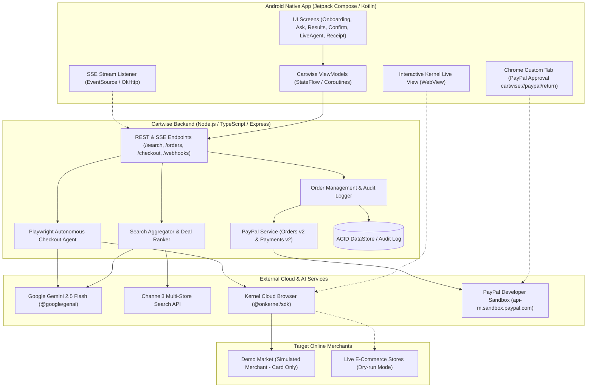

# Cartwise Architecture & Technical Specification

## 1. System Architecture Diagram

---

## 2. The Core Payment Flow: Escrow Authorization Hold
Cartwise's signature advantage is that shoppers can buy from merchants that **do not accept PayPal**, without sacrificing PayPal's security or exposing their own card details:

```mermaid
sequenceDiagram
    autonumber
    actor User as Shopper (Ada)
    participant App as Android App
    participant Backend as Cartwise Backend
    participant PayPal as PayPal Sandbox
    participant Kernel as Kernel Cloud Browser
    participant Merchant as Merchant (Demo Market)

    User->>App: "Find wireless earbuds under $40"
    App->>Backend: POST /api/search
    Backend-->>App: Top 3 Ranked Deals (SoundPulse Air: $34.99 + $5 ship)
    User->>App: Taps "Pay with PayPal" ($42.99)
    App->>Backend: POST /api/orders (create order)
    Backend->>PayPal: POST /v2/checkout/orders (intent: AUTHORIZE)
    PayPal-->>Backend: paypalOrderId + approveUrl
    Backend-->>App: approveUrl
    App->>PayPal: Opens Chrome Custom Tab (User logs in & approves)
    PayPal-->>App: Redirects to cartwise://paypal/return
    App->>Backend: POST /api/orders/:id/authorize
    Backend->>PayPal: POST /v2/checkout/orders/{id}/authorize
    PayPal-->>Backend: authorizationId (Funds held in escrow)

    rect rgb(30, 41, 59)
        note over Backend,Merchant: Autonomous Checkout Stage
        Backend->>Kernel: Create Cloud Browser Session
        Kernel-->>Backend: cdp_ws_url + browser_live_view_url
        Backend-->>App: liveViewUrl + SSE stream
        Backend->>Merchant: Playwright adds item to cart & enters shipping
        Backend->>Merchant: Injects Cartwise commercial card (Safe)
        Merchant-->>Backend: Merchant Order Confirmed (#DM-849201)
    end

    alt Happy Path (Store Confirmed)
        Backend->>PayPal: POST /v2/payments/authorizations/{authId}/capture
        PayPal-->>Backend: captureId (Status: COMPLETED)
        Backend-->>App: Receipt: Order #DM-849201, Capture #CAP-xxx
    else Failure / Stockout Guardrail
        Backend->>PayPal: POST /v2/payments/authorizations/{authId}/void
        PayPal-->>Backend: 204 No Content (Hold released)
        Backend-->>App: Alert: Item out of stock. You were NOT charged.
    end
```

---

## 3. Data Integrity & Security Standards
1. **Zero LLM Card Visibility:** Payment card details are never passed into Gemini prompt contexts. Playwright fetches credentials strictly from backend server environment variables.
2. **Atomic Price Threshold:** The agent performs an automatic total verification against the user's initial authorization limit before clicking the final submission button.
3. **Audit Trail:** Every discrete agent step is assigned an incremental sequence number, timestamp, and metadata recorded in `auditLogs`.
